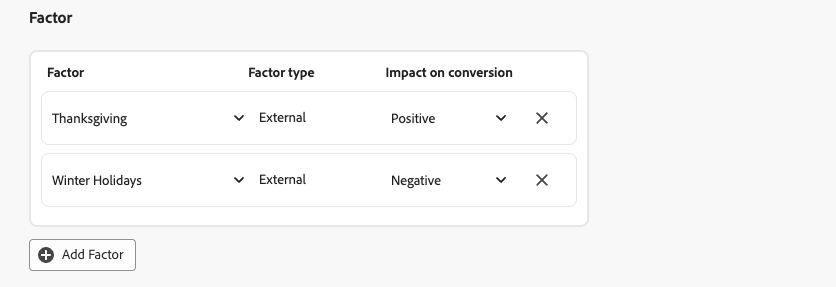
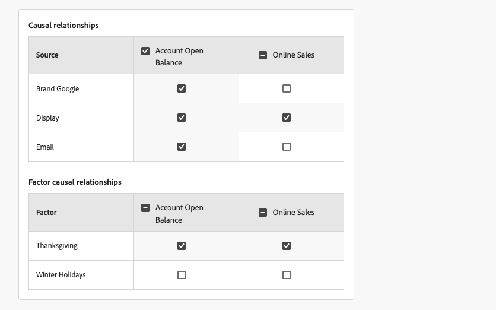
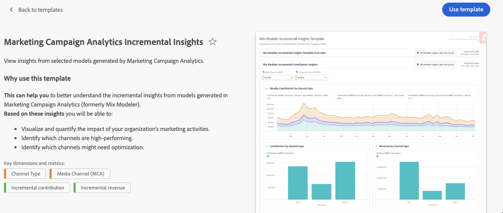

# Creare modelli

{{mm-mca-rebranding}}

Per creare modelli personalizzati basati sull’intelligenza artificiale, l’interfaccia fornisce un flusso guidato e dettagliato di configurazione del modello.

Nell&#39;interfaccia  **[!UICONTROL Models]** in [!DNL Marketing Campaign Analytics], selezionare **[!UICONTROL Open model canvas]**.

## Configurazione

È possibile definire un nome e una descrizione nel passaggio **[!UICONTROL Setup]**:

1. Immettere il modello **[!UICONTROL Name]**, ad esempio `Demo model`. Immettere un **[!UICONTROL Description]**, ad esempio `Demo model to explore AI features of Marketing Campaign Analytics`.

   

1. Selezionare **[!UICONTROL Next]** per continuare con il passaggio successivo. Selezionare **[!UICONTROL Cancel]** per annullare la configurazione del modello.

## Configurare {#configure}

>[!CONTEXTUALHELP]
>id="model_marketingtouchpoints_select"
>title="Punti di contatto di marketing"
>abstract="I punti di contatto di marketing sono eventi di marketing a livello di destinatario, singolo utente e/o cookie utilizzati per valutare l’impatto degli investimenti di marketing sulle conversioni numeriche o basate sui ricavi.  Non è possibile configurare il modello con punti di contatto che presentano dati sovrapposti ed è necessario che sia presente almeno un punto di contatto con spesa."

Il modello viene configurato nel passaggio **[!UICONTROL Configure]**. La configurazione prevede l’abilitazione della modellazione completa di funnel, la definizione degli obiettivi di conversione, i punti di contatto di marketing, la popolazione di dati idonea, fattori esterni e interni e altro ancora.

1. Se desideri abilitare [modellazione completa di funnel](./overview.md#full-funnel-modeling), nella sezione **[!UICONTROL Full funnel model]**:

   1. Seleziona **[!UICONTROL Enable full funnel modeling]**.
   1. Selezionare una conversione superiore dal menu a discesa **[!UICONTROL Upper funnel conversion]**.

1. Nella sezione **[!UICONTROL Conversion goal]**:

   

   1. Selezionare una conversione dal menu a discesa **[!UICONTROL Conversion]**. Le conversioni disponibili sono quelle definite come parte di [Conversioni](../harmonize-data/conversions.md) in [!UICONTROL Harmonized datasets]. Ad esempio, **[!UICONTROL Online Conversion]**.

   1. È possibile selezionare  **[!UICONTROL Create a conversion]** per creare una conversione direttamente dalla configurazione del modello.

1. Nella sezione **[!UICONTROL Marketing touchpoints]** puoi selezionare uno o più punti di contatto marketing, corrispondenti ai punti di contatto marketing definiti come parte di [punti di contatto marketing](../harmonize-data/marketing-touchpoints.md) in [!UICONTROL Harmonized datasets].

   

   1. Selezionare uno o più punti di contatto di marketing dal menu a discesa **[!UICONTROL Touchpoint include]**.

      * È possibile utilizzare  per rimuovere un punto di contatto.
      * È possibile utilizzare **[!UICONTROL Clear all]** per rimuovere tutti i punti di contatto.

   1. Puoi selezionare  **[!UICONTROL Create a touchpoint]** per creare un punto di contatto di marketing direttamente dalla configurazione del modello.

   >[!NOTE]
   >
   >Non è possibile impostare il modello con punti di contatto con dati sovrapposti e deve esserci almeno un punto di contatto con la spesa.

1. Per impostazione predefinita, viene generato un punteggio per tutti i dati nella vista armonizzata. Per assegnare un punteggio solo a un sottoinsieme della popolazione, definire uno o più filtri utilizzando i contenitori nella sezione **[!UICONTROL Eligible data population]**.

   

   * Per ogni contenitore, definisci uno o più eventi.

     1. Per ogni evento:

        1. Seleziona una metrica o dimensione da **[!UICONTROL _Seleziona campo armonizzato_]**.

        1. Selezionare l&#39;operatore appropriato: **[!UICONTROL equals]**, **[!UICONTROL not equals]**, **[!UICONTROL less than]**, **[!UICONTROL greater than]**, **[!UICONTROL starts with]**, **[!UICONTROL doesn't start with]**, **[!UICONTROL ends with]**, **[!UICONTROL doesn't end with]**, **[!UICONTROL contains]**, **[!UICONTROL doesn't contain]**, **[!UICONTROL is in]** o **[!UICONTROL is not in]**.

        1. Immettere o selezionare un valore in **[!UICONTROL _Immettere o selezionare il valore_]**.

     1. Per aggiungere un altro evento nel contenitore, selezionare  **[!UICONTROL Add event]**.

     1. Per rimuovere un evento dal contenitore, selezionare .

     1. Per filtrare utilizzando tutti o uno qualsiasi dei più eventi definiti nel contenitore, selezionare **[!UICONTROL Any of]** o **[!UICONTROL All of]**. L&#39;etichetta cambia di conseguenza da **[!UICONTROL Include ... Or ...]** a **[!UICONTROL Include ... And ...]**.

   * Per aggiungere un contenitore di popolazione dati idoneo, selezionare  **[!UICONTROL Add eligible population]**.

   * Per rimuovere un contenitore del gruppo di dati idoneo, all&#39;interno del contenitore, selezionare  e selezionare **[!UICONTROL Remove container]** dal menu di scelta rapida.

   * Seleziona **And** e **Or** tra contenitori per creare definizioni più complesse per la tua popolazione di dati idonea.

1. È possibile gestire set di dati contenenti fattori interni o esterni nella sezione **[!UICONTROL Factor]**.

   * Per aggiungere un set di dati fattore, selezionare **[!UICONTROL Add Factor]**. Potete aggiungere un massimo di 30 fattori a un modello.

     

     1. Selezionare **[!UICONTROL Factor dataset]** dal menu a discesa. I fattori disponibili sono i fattori per i quali hai definito un campo armonizzato in [regole set di dati](/help/harmonize-data/dataset-rules.md#create-a-dataset-rule).

        In base al set di dati selezionato, **[!UICONTROL Factor type]** è **[!UICONTROL Internal]** o **[!UICONTROL External]**.

     1. Selezionare **[!UICONTROL Impact on conversion]** dal menu a discesa. Opzioni disponibili: **[!UICONTROL Auto]**, **[!UICONTROL Positive]** o **[!UICONTROL Negative]**. L&#39;opzione predefinita è **[!UICONTROL Auto]**, che consente al modello di determinare l&#39;impatto del set di dati del fattore.

   * Per eliminare un set di dati di fattore, selezionare .

   * Se il modello è abilitato per la [modellazione completa di funnel](./overview.md#full-funnel-modeling), è necessario definire relazioni causali e relazioni causali dei fattori aggiunti al modello.

     

     * Per definire le relazioni causali, nella tabella **[!UICONTROL Causal relationship]** s selezionare  per ogni canale (**[!UICONTROL Source]**) per indicare se il canale influenza i KPI di conversione superiore e inferiore.

       È possibile selezionare  nell&#39;intestazione di colonna per l&#39;indicatore KPI di conversione superiore e inferiore per definire rapidamente che tutti i canali influenzano l&#39;indicatore KPI.

     * Una volta definiti i fattori, si definiscono le relazioni causali dei fattori. Per definire le relazioni causali tra i fattori, nella tabella **[!UICONTROL Factor causal relationships]** selezionare  per ogni fattore (**[!UICONTROL Factor]**) per indicare se il fattore influenza i KPI di conversione superiore e inferiore.

       È possibile selezionare  nell&#39;intestazione di colonna dell&#39;indicatore KPI di conversione superiore e dell&#39;indicatore KPI di conversione inferiore per definire rapidamente che tutti i fattori influenzano l&#39;indicatore KPI.

1. Per definire l&#39;intervallo di lookback del modello, immettere un valore compreso tra `1` e `52` in **[!UICONTROL Give contribution credit to touchpoints occurring within]** ... **[!UICONTROL weeks prior to the conversion]** nella sezione **[!UICONTROL Define lookback window]**.

   Se il modello è abilitato per la [modellazione completa di funnel](./overview.md#full-funnel-modeling):

   * Per definire l&#39;intervallo di lookback per il funnel inferiore, immettere un valore compreso tra `1` e `52` in **[!UICONTROL Give contribution credit to touchpoints occurring within]** ... **[!UICONTROL weeks prior to the conversion]** per **[!UICONTROL Lower funnel]** nella sezione **[!UICONTROL Define lookback window]**.

   * Per definire l&#39;intervallo di lookback per il funnel superiore, immettere un valore compreso tra `1` e `52` in **[!UICONTROL Give contribution credit to touchpoints occurring within]** ... **[!UICONTROL weeks prior to the upper funnel conversion]** per **[!UICONTROL Upper funnel]** nella sezione **[!UICONTROL Define lookback window]**.

1. Per definire la finestra di formazione per un modello, in **[!UICONTROL Define training window]**, seleziona il punto in cui iniziare a valutare le conversioni.

   

   Puoi scegliere tra:

   * **[!UICONTROL Have Marketing Campaign Analytics select a helpful training window]** e

   * **[!UICONTROL Manually input a training window]**. Se selezionata, definire il numero di anni in **[!UICONTROL Include events the following years prior to a conversion]**.

   Questo input è necessario per un modello. Il numero di anni determina il limite di channel adstock che è possibile configurare nel passaggio **[!UICONTROL Advanced]**.

1. Selezionare **[!UICONTROL Next]** per continuare con il passaggio successivo. Se è necessaria una configurazione maggiore, una struttura e un testo rossi spiegano quale configurazione aggiuntiva è necessaria.  Selezionare **[!UICONTROL Back]** per tornare al passaggio precedente.  Selezionare **[!UICONTROL Cancel]** per annullare la configurazione del modello.

## Avanzate {#advanced}

>[!CONTEXTUALHELP]
>id="model_advanced_channeladstock"
>title="Canale stock annunci"
>abstract="Incorpora le competenze del dominio, i risultati delle sperimentazioni o le analisi di canale precedenti direttamente nella configurazione del modello. La configurazione dello stock annunci consente di allineare il modello alle aspettative reali, migliorando l’interpretabilità e l’affidabilità dei risultati. Il totale delle settimane di lookback più le settimane di attesa per ciascun canale non può superare un ottavo dell’intervallo di addestramento configurato. Questo limite consente di disporre dati sufficienti affinché il modello possa apprendere gli effetti dello stock annunci."

È possibile specificare impostazioni avanzate nel passaggio **[!UICONTROL Advanced]**. In questo passaggio puoi definire [condivisione di spesa](#spend-share), abilitare il tuo modello per [attribuzione multi-touch (MTA)](#mta), definire [conoscenza precedente](#prior-knowledge) e definire [channel adstock](#channel-adstock).

### Condivisione di spesa

Nella sezione **[!UICONTROL Spend share]**:

* Per utilizzare i rapporti di investimento di marketing storici per informare il modello quando i dati di marketing sono sparsi, attivare **[!UICONTROL Allow spend share]**.

  Se il modello è abilitato per la [modellazione completa di funnel](./overview.md#full-funnel-modeling):

  * Per utilizzare i rapporti di investimento di marketing storici per informare il modello quando i dati di marketing sono sparsi, attivare **[!UICONTROL Allow spend share for the lower funnel]**.
  * Per utilizzare i rapporti di investimento di marketing storici per informare il modello quando i dati di marketing sono sparsi, attivare **[!UICONTROL Allow spend share for the upper funnel]**.

* Si consiglia questa impostazione, in particolare nei seguenti scenari:
  * Un canale non dispone di un numero sufficiente di osservazioni (ad esempio, bassa frequenza di spesa, impression o clic).
  * Stai modellando contenuti multimediali ad alto contenuto ma regolari e potenzialmente molto spesi (come la TV per alcuni marchi), dove i dati sono scarsi.

  >[!NOTE]
  >
  >Per investimenti una tantum (ad esempio un annuncio per il Super Bowl), incorpora tali dati come fattore invece di fare affidamento sulla quota di spesa.
  >

### MTA

Nella sezione **[!UICONTROL MTA enabled]**:

* Per abilitare le funzionalità MTA per il modello, attiva **[!UICONTROL MTA enabled]**. Se hai abilitato l’MTA, gli approfondimenti sull’attribuzione multi-touch sono disponibili dopo aver addestrato e valutato il modello. Consulta la scheda [Attribuzione](insights.md#attribution) in [Informazioni sul modello](insights.md).

### Conoscenze precedenti

Nella sezione **[!UICONTROL Prior knowledge]**:

1. Selezionare **[!UICONTROL Rule type]**, che è per impostazione predefinita **[!UICONTROL Absolute values]**.

1. Se il modello è abilitato per la [modellazione completa di funnel](./overview.md#full-funnel-modeling):

   * Selezionare **[!UICONTROL Lower funnel]** o **[!UICONTROL Upper funnel]** da **[!UICONTROL Select metric]** come metrica di funnel da utilizzare in precedenza.

1. Specificare le percentuali di contributo per i canali elencati in **[!UICONTROL Name]**, utilizzando la colonna **[!UICONTROL Contribution proportion]**.

1. Se appropriato, puoi aggiungere per ogni canale una percentuale di **[!UICONTROL Level of confidence]**.

1. Se necessario, utilizzare **[!UICONTROL Clear all]** per cancellare tutti i valori di input per le colonne **[!UICONTROL Contribution proportion]** e **[!UICONTROL Level of confidence]**.

### Canale stock annunci

Nella sezione **[!UICONTROL Channel adstock]** è possibile definire singoli lookback di adstock (effetti di trascinamento o decadimento) e ritardi (tempi di risposta ritardati) per ogni canale (canale di marketing) definito nel modello.

Questa configurazione di channel adstock consente un controllo dettagliato sul modo in cui i diversi canali di marketing influiscono sui risultati aziendali nel tempo. In alternativa, è possibile utilizzare i valori predefiniti di sistema e una configurazione standard.

La configurazione di channel adstock consente di acquisire sfumature specifiche per il canale. Ad esempio, l’impatto a lungo termine delle campagne TV, l’impatto a breve termine della ricerca a pagamento o il ritardo tra la spesa degli influencer e le conversioni osservabili. Sperimenta i parametri di lookback e lag di adstock per generare informazioni più precise, personalizzate e affidabili. In ultima analisi, una configurazione di channel adstock può portare a allocazioni di budget più precise e a decisioni aziendali migliori.

Per configurare il canale adstock:

* Se il modello è abilitato per la [modellazione completa di funnel](./overview.md#full-funnel-modeling), selezionare **[!UICONTROL Lower funnel]** o **[!UICONTROL Upper funnel]** da **[!UICONTROL Select metric]** come metrica di funnel da utilizzare per channel adstock.

* Per ogni canale (**[!UICONTROL Name]**), definire un valore **[!UICONTROL Lag (weeks)]**, **[!UICONTROL Min Lookback (weeks)]** e **[!UICONTROL Max Lookback (weeks)]**. Per ogni valore:

  * Per aumentare un valore, utilizzare ; per diminuire un valore, utilizzare  oppure immettere un valore manualmente.

  Il totale delle settimane di lag più il massimo delle settimane di lookback per canale è limitato a un ottavo della finestra di apprendimento configurata. Questo limite consente di disporre dati sufficienti affinché il modello possa apprendere gli effetti dello stock annunci. Ad esempio, per un intervallo di formazione di due anni, il massimo di **[!UICONTROL Lag (weeks)]** e **[!UICONTROL Lookback (weeks)]** per un canale è 13 settimane. Questo limite viene applicato quando si definiscono i valori.

* Per ripristinare i valori predefiniti di tutti i canali adstock:

  * Seleziona **[!UICONTROL Reset to defaults]**.

## Impostare le opzioni

Puoi [pianificare l&#39;apprendimento e il punteggio](#schedule) e specificare [campi di reporting di approfondimenti granulari](#granular-insights-reporting-fields) per il modello nel passaggio **[!UICONTROL Set options]**.

### Pianificazione

Nella sezione **[!UICONTROL Schedule]** è possibile pianificare l&#39;apprendimento del modello e il punteggio.

Per pianificare l’apprendimento e il punteggio del modello:

1. Attiva **[!UICONTROL Enable scheduled model scoring and training]**.
1. Seleziona **[!UICONTROL Scoring frequency]**:

   * **[!UICONTROL Daily]**: immettere un&#39;ora valida (ad esempio `05:22 pm`) oppure utilizzare  per definire l&#39;ora.
   * **[!UICONTROL Weekly]**: selezionare un giorno della settimana e immettere un&#39;ora valida (ad esempio `05:22 pm`) oppure utilizzare  per definire l&#39;ora.
   * **[!UICONTROL Monthly]**: selezionare un giorno del mese dal menu a discesa Esegui su ogni e immettere un&#39;ora valida (ad esempio `05:22 pm`) oppure utilizzare  per definire l&#39;ora.

1. Selezionare **[!UICONTROL Training frequency]** dal menu a discesa: **[!UICONTROL Monthly]**, **[!UICONTROL Quarterly]**, **[!UICONTROL Yearly]** o **[!UICONTROL None]**.

### Customer Journey Analytics {#cja}

>[!CONTEXTUALHELP]
>id="model_enable_cja"
>title="Abilitare Customer Journey Analytics"
>abstract="Abilita questa impostazione per rendere i dati di punteggio disponibili per Customer Journey Analytics a scopo di reporting e analisi. Una volta attivato, devi eliminare il modello per disabilitare questa impostazione."

{{release-limited-testing-section}}

Se hai diritto a Customer Journey Analytics e hai creato una o più [regole set di dati](/help/harmonize-data/dataset-rules.md) per Marketing Campaign Analytics in una particolare sandbox:

* Nella sandbox di Experience Platform vengono creati due set di dati Marketing Campaign Analytics dedicati.
* È stata creata una [connessione](https://experienceleague.adobe.com/it/docs/analytics-platform/using/cja-connections/overview) Customer Journey Analytics, denominata **[!UICONTROL Marketing Campaign Analytics Enabled Connection (_nome-sandbox _)]**, contenente i set di dati Marketing Campaign Analytics dedicati.
* In base alla connessione, viene creata una [visualizzazione dati](https://experienceleague.adobe.com/it/docs/analytics-platform/using/cja-dataviews/data-views) di Customer Journey Analytics con titolo **[!UICONTROL Marketing Campaign Analytics Insights Data View (_nome-sandbox _)]**.

Sia la connessione che la visualizzazione dati sono di proprietà del sistema. Impossibile aggiornare o eliminare la connessione o la visualizzazione dati.

Per rendere i dati del punteggio modello disponibili a Customer Journey Analytics tramite i set di dati, la connessione e la visualizzazione dati sopra menzionati:

* Seleziona **[!UICONTROL Enable scores for Customer Journey Analytics]**.

  Dopo aver attivato questa impostazione, è possibile disattivarla solo eliminando il modello.

Per creare rapporti e analizzare rapidamente i dati di Marketing Campaign Analytics, in un [progetto Workspace](https://experienceleague.adobe.com/it/docs/analytics-platform/using/cja-workspace/home) di Customer Journey Analytics:

1. Selezionare **[!UICONTROL Workspace]** > **[!UICONTROL Adobe templates]**.
1. Seleziona la **[!UICONTROL Marketing Campaign Analytics Insights Data View (_sandbox-name _)]**&#x200B;dedicata come visualizzazione dati da utilizzare per un progetto.
1. Selezionare il **[!UICONTROL Marketing Campaign Analytics Incremental Insights]** [modello](https://experienceleague.adobe.com/en/docs/analytics-platform/using/cja-workspace/templates/use-templates#marketing-campaign-analytics-templates).
   * Seleziona **[!UICONTROL Preview]** per visualizzare un&#39;anteprima.

     
   * Selezionare **[!UICONTROL Use template]** per creare un progetto basato sul modello.

### Campi di reporting per approfondimenti granulari

La sezione **[!UICONTROL Granular insights reporting fields]** utilizza la funzionalità di reporting con incremento granulare. Questa funzionalità ti consente di selezionare campi armonizzati per suddividere i punteggi di conversione e di incrementalità dei punti di contatto.

Puoi definire questi campi armonizzati in modo da poter analizzare in profondità il reporting del modello utilizzando colonne di reporting granulari invece di dover creare modelli separati.

Ad esempio, puoi creare un modello incentrato sui ricavi, ma sei anche interessato alle prestazioni della campagna, del tipo di media, dell’area geografica e dell’origine del traffico. Senza la funzionalità di reporting con incrementalità granulare, è necessario creare quattro modelli separati. Con la funzionalità di reporting granulare per incrementalità, puoi suddividere il modello di ricavi per campagne, tipi di media, aree geografiche e origini di traffico.

1. Seleziona uno o più campi armonizzati da **[!UICONTROL _Seleziona campi armonizzati_]** sotto **[!UICONTROL Includes]**. I campi armonizzati selezionati vengono aggiunti al pannello.
1. Selezionare **[!UICONTROL *Campo armonizzato *]** per rimuovere un campo armonizzato dal contenitore con i campi armonizzati selezionati.
1. Selezionare **[!UICONTROL Clear all]** per rimuovere tutti i campi armonizzati selezionati.

I campi armonizzati selezionati per il reporting di incrementalità granulare sono disponibili come parte del [schema](/help/ingest-data/schemas.md) e del [set di dati](/help/ingest-data/datasets.md) di Experience Platform risultante dal punteggio del modello. I campi di reporting delle informazioni granulari sono disponibili negli oggetti **[!UICONTROL conversionPassthrough]** e **[!UICONTROL touchpointPassthrough]**.

## Fine

* Seleziona **[!UICONTROL Finish]** per completare la configurazione del modello.

  * Nella finestra di dialogo **[!UICONTROL Create instance?]**, seleziona **[!UICONTROL Ok]** per attivare immediatamente il primo set di addestramento e punteggio. Il modello è elencato con lo stato  **[!UICONTROL Awaiting training]**.

    Selezionare **[!UICONTROL Cancel]** per annullare.

  * Se è necessaria una configurazione maggiore, una struttura e un testo rossi spiegano quale configurazione aggiuntiva è necessaria.

* Selezionare **[!UICONTROL Back]** per tornare al passaggio precedente.

* Selezionare **[!UICONTROL Cancel]** per annullare la configurazione del modello.

