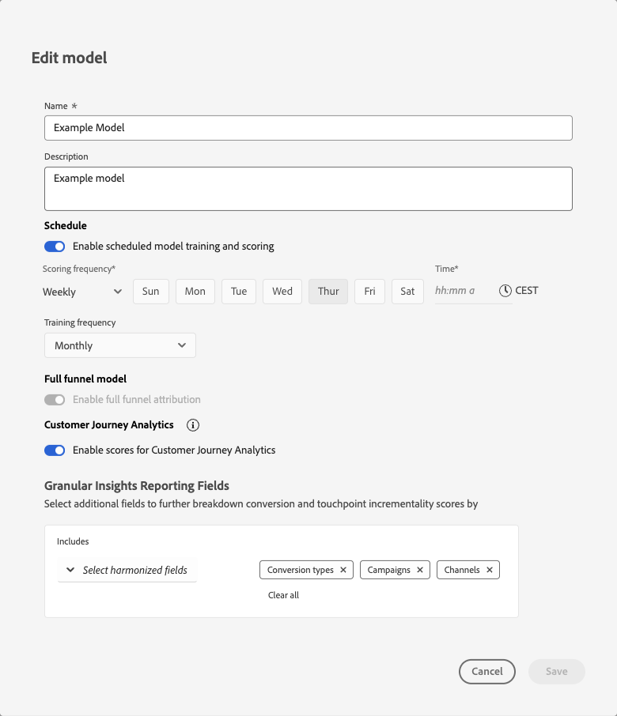

# Panoramica dei modelli

{{mm-mca-rebranding}}

La funzionalità dei modelli di Marketing Campaign Analytics consente di configurare, addestrare e valutare modelli specifici per gli obiettivi aziendali. La formazione e il punteggio supportano l’apprendimento del trasferimento basato sull’intelligenza artificiale tra attribuzione multitouch e modellazione marketing mix.

I modelli si basano sui dati armonizzati creati come parte del flusso di lavoro dell’applicazione.

Un modello in Marketing Campaign Analytics è un modello di apprendimento automatico utilizzato per misurare e prevedere un risultato specifico basato sugli investimenti di un addetto marketing. I punti di contatto di marketing e i dati di riepilogo possono essere utilizzati come input. Marketing Campaign Analytics consente di creare varianti di modelli basati su diversi set di variabili, dimensioni e risultati, come ricavi, unità vendute, lead.

Un modello richiede:

* Una conversione.
* Uno o più punti di contatto di marketing (canali) costituiti da dati a livello di riepilogo, dati dei punti di contatto di marketing (dati evento) o entrambi.
* Un intervallo di lookback configurabile.
* Una finestra di formazione configurabile.

Un modello può facoltativamente includere:

* Fattori esterni.
* Fattori interni.
* Conoscenza preventiva dei contributi di marketing da altre fonti, come la precedente esperienza delle parti interessate, test incrementali, altri modelli.
* La condivisione di spesa, che utilizza come proxy la condivisione di spesa relativa quando i dati di marketing sono sparsi.

La prima volta che viene creato un modello, la creazione avvia immediatamente il processo di formazione e punteggio. Dopo il completamento dell’esecuzione iniziale dell’addestramento e del punteggio, gli approfondimenti del modello sono disponibili per la revisione. Un modello può essere successivamente riqualificato. Inoltre, i dati possono essere aggiunti al modello che richiede il ripristino manuale del modello. La riqualificazione e il ricalcolo sono un processo iterativo, in quanto emergono nuovi risultati e informazioni e sono necessari adeguamenti per ottenere un adattamento del modello più appropriato per gli obiettivi aziendali.

## Modellazione Full funnel

{{release-limited-testing-section}}

La modellazione completa di funnel consente di modellare le fasi reali del funnel. Ad esempio, dall’iscrizione alla newsletter fino a un acquisto. La modellazione completa di funnel mostra come il marketing sposta i clienti attraverso quel funnel. La modellazione completa di funnel attribuisce il merito ai canali funnel superiori per le conversioni che questi canali influenzano a valle e riconcilia i risultati in modo che i contributi si sommino correttamente senza doppi conteggi.

Puoi utilizzare la modellazione completa di funnel per modellare su un indicatore KPI funnel superiore insieme a un indicatore KPI funnel inferiore.

* Esempi di KPI superiori di funnel sono le iscrizioni a newsletter e altre metriche di brand awareness.
* Esempi di metriche funnel inferiori sono le metriche di conversione tipiche, come ricavi e ordini.

Le tattiche del funnel superiore spesso ottengono meno credito in un modello MMM incentrato sulla conversione. La modellazione completa di funnel consente di comprendere:

* Quali tattiche mediatiche e di marketing hanno contribuito all’obiettivo superiore di funnel.
* Quali tattiche mediatiche e di marketing hanno avuto un impatto indiretto sull’obiettivo di conversione. I pesi massimi del modello funnel sono un input per il modello funnel inferiore per dare maggiore peso ai media e alle tattiche di marketing, se del caso.

## Creare modelli

Per creare un modello, utilizzare il flusso di configurazione guidato passo passo del modello di Marketing Campaign Analytics disponibile quando si seleziona **[!UICONTROL Open model canvas]**. Per ulteriori dettagli, vedi [Modelli di compilazione](build.md).

## Gestisci modelli

Per visualizzare una tabella dei modelli correnti, nell’interfaccia di Marketing Campaign Analytics:

1. Seleziona  **[!UICONTROL Models]** dalla barra a sinistra.

1. Viene visualizzata una tabella dei modelli correnti.

   Le colonne della tabella specificano i dettagli relativi al modello.

   | Nome colonna | Dettagli |
   |---|---|
   | **[!UICONTROL Name]** | Nome del modello. Se un modello è abilitato per la modellazione completa di funnel, verrà visualizzato un bage di [!BADGE Full funnel]{type=Informative}. |
   | **[!UICONTROL Description]** | Descrizione del modello. |
   | **[!UICONTROL Conversion event]** | Conversione selezionata per il modello. |
   | **[!UICONTROL Run frequency]** | Frequenza di esecuzione dell&#39;addestramento del modello. |
   | **[!UICONTROL Last run]** | La data e l’ora dell’ultimo addestramento del modello. |
   | **[!UICONTROL Status]** | Stato del modello. |

   Per ordinare la tabella in qualsiasi colonna in ordine crescente  o decrescente , selezionare il titolo della colonna.

   Per ordinare o ridimensionare la colonna **[!UICONTROL Name]**, selezionare **[!UICONTROL Name]** . Dal menu di scelta rapida selezionare **[!UICONTROL Sort ascending]**, **[!UICONTROL Sort descending]** o **[!UICONTROL Resize column]**. In alternativa, è possibile passare il puntatore del mouse sul separatore di colonna per ridimensionare la colonna **[!UICONTROL Name]**.

   Lo stato segnalato del modello dipende dalla posizione in cui si trova un modello all&#39;interno del suo ciclo di vita. Ad esempio, se un modello viene creato, o riaddestrato con successo o meno, o ha ottenuto o ottenuto nuovamente un punteggio.

   Nella tabella seguente:

   * : indica la corretta esecuzione di un passaggio del ciclo di vita del modello.
   * : indica un&#39;esecuzione corrente continua di un passaggio del ciclo di vita del modello.
   *  - indica una mancata esecuzione di un passaggio nel ciclo di vita del modello.

   | Stato | [Build](/help/models/build.md) | [Addestra](/help/models/train-score.md#train) | [Punteggio](/help/models/train-score.md#score) | [Riprova](/help/models/train-score.md#train) | [Riscore](/help/models/train-score.md#score) |
   |---|:---:|:---:|:---:|:---:|:---:|
   | In corso |  | | | | |
   | In corso |  |  | | | |
   | In corso |  |  |  | | |
   | In corso |  |  |  |  | |
   | In corso |  |  |  |  |  |
   | Addestramento non riuscito |  |  | | | |
   | Addestramento non riuscito |  |  |  |  | |
   | Formazione completata |  |  | | | |
   | Formazione completata |  |  |  |  | |
   | Punteggio non riuscito |  |  |  | | |
   | Punteggio non riuscito |  |  |  |  |  |
   | Punteggio riuscito |  |  |  | | |
   | Punteggio riuscito |  |  |  |  |  |

   {style="table-layout:fixed"}

1. Per modificare le colonne visualizzate per l&#39;elenco, selezionare  e attivare o disattivare le colonne in .

È possibile eseguire le azioni seguenti su un modello specifico.

### Approfondimenti modello

La funzionalità Approfondimenti modello è disponibile solo su modelli con formazione e punteggi completati.

Per visualizzare le informazioni di un modello:

1. Seleziona  **[!UICONTROL Models]** dalla barra a sinistra.
1. Selezionate il nome del modello.

Sei stato reindirizzato a [Model Insights](insights.md).

### Visualizza dettagli

Per visualizzare ulteriori dettagli su un modello:

1. Seleziona  **[!UICONTROL Models]** dalla barra a sinistra.

1. Seleziona  per un modello per visualizzare un popup con dettagli come **[!UICONTROL Description]**, **[!UICONTROL Run frequency]**, **[!UICONTROL Last run status]**, **[!UICONTROL Spend share]** e altro ancora.

### Duplica

Potete duplicare rapidamente un modello.

1. Seleziona  **[!UICONTROL Models]** dalla barra a sinistra.

1. Seleziona  per un modello e dal menu di scelta rapida seleziona **[!UICONTROL Duplicate]**.

Sei stato reindirizzato ai passaggi per creare un nuovo modello, con un nome proposto composto dal nome del modello originale seguito da **[!UICONTROL (Copy)] (_n_)**.

### Modifica

Puoi modificare il nome, la descrizione e la pianificazione dell’apprendimento e del punteggio di un modello.

1. Seleziona  **[!UICONTROL Models]** dalla barra a sinistra.

1. Seleziona  per un modello e dal menu di scelta rapida seleziona **[!UICONTROL Edit]**.

   Nella finestra di dialogo **[!UICONTROL Edit model]**:

   

   * Immettere un nuovo **[!UICONTROL Name]** e **[!UICONTROL Description]**.

   * Per abilitare la pianificazione, abilitare **[!UICONTROL Enable schedule model training and scoring]**. Puoi abilitare la pianificazione solo per i modelli che sono stati addestrati e valutati.

     1. Seleziona **[!UICONTROL Scoring frequency]**:

        * **[!UICONTROL Daily]**: immettere un&#39;ora valida (ad esempio `10:00 am`) oppure utilizzare  per definire l&#39;ora.
        * **[!UICONTROL Weekly]**: selezionare un giorno della settimana e immettere un&#39;ora valida (ad esempio `10:00 am`) oppure utilizzare  per definire l&#39;ora.
        * **[!UICONTROL Monthly]**: selezionare un giorno del mese dal menu a discesa Esegui su ogni e immettere un&#39;ora valida (ad esempio `10:00 am`) oppure utilizzare  per definire l&#39;ora.

     1. Selezionare **[!UICONTROL Training frequency]** dal menu a discesa: **[!UICONTROL Monthly]**, **[!UICONTROL Quarterly]**, **[!UICONTROL Yearly]** o **[!UICONTROL None]**.

   * Per aggiornare i campi di reporting di [granular insights](/help/models/build.md#granular-insights-reporting-fields), nella sezione **[!UICONTROL Granular Insights Reporting Fields]**:
     1. Seleziona uno o più campi armonizzati da **[!UICONTROL _Seleziona campi armonizzati_]** sotto **[!UICONTROL Includes]**. I campi armonizzati selezionati vengono aggiunti al pannello.
     1. Selezionare **[!UICONTROL *Campo armonizzato *]** per rimuovere un campo armonizzato dal contenitore con i campi armonizzati selezionati.
     1. Selezionare **[!UICONTROL Clear all]** per rimuovere tutti i campi armonizzati selezionati.

     >[!IMPORTANT]
     >Qualsiasi modello con MTA creato prima del 12 gennaio 2026 deve essere duplicato per abilitare informazioni granulari sul modello. 
     >La registrazione è necessaria affinché qualsiasi modello esistente rifletta le dimensioni granulari aggiornate nei dati di punteggio.
     >

1. Seleziona **[!UICONTROL Save]**.

### Addestra

Conserva un modello quando desideri includere nuovi dati di marketing e di fattore incrementali. Per ulteriori informazioni, vedere [Modelli di addestramento e valutazione](train-score.md#train).

### Punteggio

Puoi assegnare un punteggio incrementale a un modello in base a nuovi dati di marketing o ripristinare un modello per un intervallo di date specifico. Per ulteriori informazioni, vedere [Modelli di addestramento e valutazione](train-score.md#score).

### Elimina modelli

Per eliminare un modello:

1. Seleziona  **[!UICONTROL Models]** dalla barra a sinistra.
1. Seleziona  per un modello e dal menu di scelta rapida seleziona **[!UICONTROL Delete]**. In alternativa, selezionare  **[!UICONTROL Delete]** dalla barra delle azioni blu.
1. Selezionare **[!UICONTROL Delete]** nella finestra di dialogo di conferma **[!UICONTROL Delete model]** per eliminare il modello. Selezionare **[!UICONTROL Cancel]** per annullare.

Per eliminare più modelli:

1. Seleziona più modelli.
1. Dalla barra blu delle azioni, seleziona  **[!UICONTROL Delete]** per eliminare i modelli.
1. Selezionare **[!UICONTROL Delete]** nella finestra di dialogo di conferma **[!UICONTROL Delete *x *modelli]**&#x200B;per eliminare i modelli. Selezionare **[!UICONTROL Cancel]**&#x200B;per annullare.

